# Workflows

PAW has two workflows:

- **Implementation** (`PAW` agent, `paw-workflow` skill) — takes a task from an issue or prompt to one pull request.
- **PAW Review** (`PAW-Review` agent, `paw-review-workflow` skill) — helps you review an existing pull request and drafts comments as a pending review.

PAW Lite is no longer a separate workflow. It is the `lite` [preset](workflow-presets.md#presets) of the implementation workflow; the `paw-lite` skill loads `paw-workflow` with that preset.

## Implementation Workflow

```mermaid
graph LR
    S[Setup] --> SH[Shape]
    SH --> SP[Specify]
    SP --> R[Research]
    R --> P[Plan]
    P --> PR[Plan review]
    PR --> CP[Plan checkpoint]
    CP --> I[Implement units]
    I --> FR[Final review]
    FR --> F[Final PR]
    style SH stroke-dasharray: 5 5
    style SP stroke-dasharray: 5 5
    style R stroke-dasharray: 5 5
    style PR stroke-dasharray: 5 5
    style CP stroke-dasharray: 5 5
    style FR stroke-dasharray: 5 5
```

Dashed steps run only when the configuration turns them on.

### The Agent and the Todo Graph

The agent you talk to is the **host**. It orchestrates; it does not write the spec, plan or code itself. Before any other work, it builds a todo graph from the resolved configuration and then works through it:

| Todo | Runs when | Output |
|------|-----------|--------|
| `setup` | Always | `WorkflowContext.md`, target branch |
| `shape` | `shaping: on`, or `auto` and the task is vague | `WorkShaping.md`, written with you in the host session |
| `specify` | `spec: on` | `Spec.md` |
| `research` | `research: dedicated` | `CodeResearch.md` |
| `plan` | Always | `ImplementationPlan.md` |
| `plan-review` | `plan_review.mode` is not `off` | Review files in `reviews/planning/` |
| `plan-checkpoint` | `plan_checkpoint: on` | Your acceptance of the plan |
| `expand-plan` | Always | One `implement:<unit>` todo per plan unit |
| `final-review` | `final_review.mode` is not `off` | Review files in `reviews/` |
| `final-pr` | Always | The pull request |

During the run the host adds todos as needed:

- `implement:<unit>` for each unit of the accepted plan, and `review:<unit>` after each when `phase_review: on`.
- `revise:<target>` when a review returns findings.
- `candidate:<slug>` when a subagent reports related work it noticed. Each candidate is implemented or recorded in the plan as deferred before the final PR.

The host closes a todo only with evidence on disk: the artifact, the commits, or the review output. It cancels a todo only when you tell it to. It stops only when the graph is complete, a todo needs your decision, the plan checkpoint is reached, or you ask it to stop. Asking it to go faster changes configuration, not these rules.

### Activities

Specify, research, plan, implement and review each run in a subagent with a brief: the task, the project and user instructions that apply, the inputs to read, and what "done" means. Subagents commit locally on the target branch. Only the host pushes, opens the pull request, or changes artifact tracking.

- **Specify** writes testable requirements and acceptance criteria. It does not ask you questions; low-impact unknowns become assumptions, and a blocking product question comes back to you as a decision.
- **Research** documents how the relevant code works today, with `file:line` references. With `research: inline` (the default), the plan subagent does this research itself.
- **Plan** writes `ImplementationPlan.md`: findings, decisions, units of work with their changes, tests and "done when" checks, and what is out of scope. With two or more `planning.models`, one plan is drafted per model and the first planner merges them.
- **Implement** runs one subagent per unit, in order; units the plan marks as independent may run in parallel (`implementation.parallel: auto`). A unit is accepted only when every deliverable the plan names for it exists and its validation passes.
- **Review** runs through the configured [review provider](workflow-presets.md#review-providers). Findings marked `must-fix` or `should-fix` go back to the subagent that produced the work; findings that need a product decision come to you.

Uncommitted changes you had before the run are never staged, committed or reverted.

### Plan Checkpoint

With `plan_checkpoint: on`, the host stops after the plan (and plan review, if configured) and waits for you. Ask for changes and the host sends them to the subagent that wrote the plan, with the decisions accepted so far and the points that must not regress. Say you accept the plan and implementation starts.

With the default `plan_checkpoint: off`, the host accepts the plan itself after its checks and continues.

### Final Pull Request

When every other todo is done, the host runs the final PR procedure:

1. Checks that every configured review left its output, the project's test, lint and build commands pass, and every plan unit is delivered.
2. With `commit-and-clean`, stops tracking `.paw/work/<work-id>/` in a separate commit (see [Artifact lifecycle](workflow-presets.md#artifact-lifecycle)).
3. Pushes the target branch and opens one pull request to the base branch with `gh pr create`. If a PR for the branch already exists, it updates that PR instead.

The PR description covers the summary, the task, the changes, validation, review outcome (including findings deferred and why), a link to the artifacts, and breaking changes.

### Resume

To continue a work item in a new session, ask the PAW agent to continue it by work id or branch. The host finds `WorkflowContext.md` (in the checkout, on another branch, or in the work item's worktree), switches to the target branch, and rebuilds the todo graph. It closes a todo only when its evidence exists now: an artifact, review output, commits that deliver every planned deliverable of a unit with validation passing, or an open PR for the branch. Anything partial stays open. It tells you what it closed and continues without re-planning.

A work item started with PAW v1 can be resumed too; see [Migrating from v1](migration.md#in-flight-v1-work-items).

### Rewind

To go back to an earlier activity or change accepted work (spec, plan, or an implemented unit), say so: "go back to the plan and split unit 2". The `paw-rewind` skill routes to the same procedure.

1. The host shows a preview: the earliest todo whose output changes, every todo it will reopen, and how each affected commit will be superseded. Nothing changes until you confirm.
2. It reopens those todos, revises the target artifact through the subagent that owns it, and redoes affected units with new commits on top (or `git revert` for work the change removes).

A rewind never rewrites history: no reset, rebase, amend or force push. An existing pull request is updated by pushing, never duplicated.

## PAW Review

PAW Review is a separate workflow for reviewing someone else's pull request (GitHub or Azure DevOps) or a local branch. Start it with `copilot --agent PAW-Review`, or `/paw-review <PR>` in VS Code, and give the PR.

It works backward from the change: understanding (context, baseline research at the base commit, derived spec), evaluation (impact and gap analysis, or society-of-thought), then feedback, critique and a finalized comment set. On GitHub the comments are posted as a **pending** review you edit and submit yourself; PAW Review submits only when you explicitly authorize it for the exact PR, head commit and event. Azure DevOps and local reviews produce artifacts and manual posting instructions.

PAW Review uses the same host model as the implementation workflow: a todo graph, one subagent per stage, and only the host posts to the PR platform. It supports the `single-model` (default) and `society-of-thought` review modes. See the [Review Workflow specification](../specification/review.md).

## Next Steps

- [Configuration and Presets](workflow-presets.md) — Every setting and its default
- [Society-of-Thought Review](society-of-thought-review.md) — The specialist review engine
- [Artifacts Reference](../reference/artifacts.md) — What each file contains
