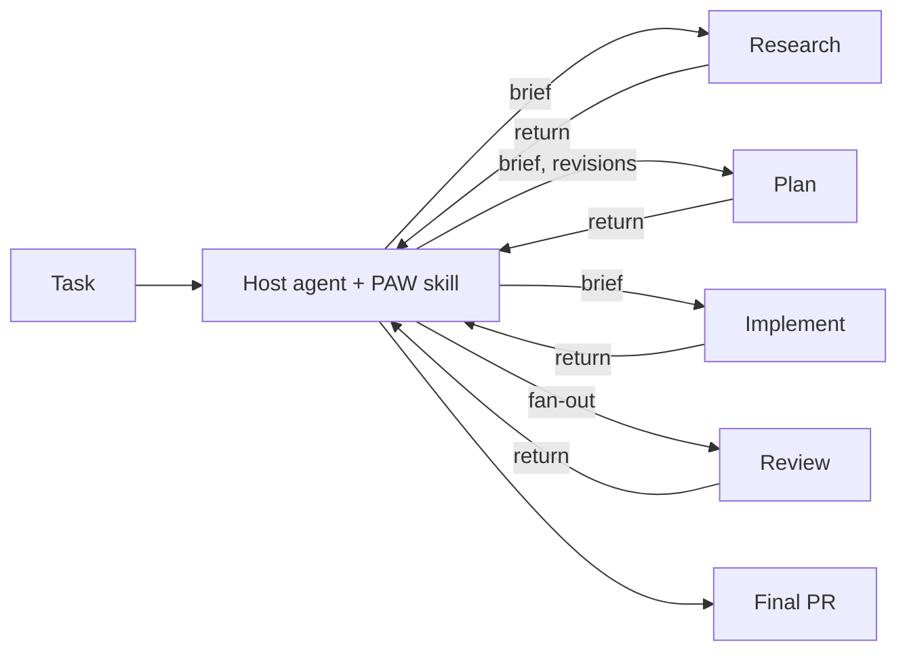

# PAW v2 Design

!!! note "Status: draft for review"
    Phase 0 output for [#322](https://github.com/lossyrob/phased-agent-workflow/issues/322). Nothing here is implemented yet. The [decisions](#decisions) at the end were accepted on 2026-11-09.

Companion pages: [Invariant Catalogue](invariants.md) and [Runtime Capabilities](runtime-capabilities.md).

## Shape

PAW v2 is one workflow skill that a host agent loads. The host orchestrates; activities run in subagents; the host's TODO graph is the only control state.



| Component | Role |
|-----------|------|
| Workflow skill | The TODO graph template, the host rules, the contracts on this page |
| Activity briefs | One file per activity under the skill's `references/`; read by the subagent, not the host |
| Operation procedures | Git operations, final PR, rewind; loaded by the host when the matching TODO starts |
| Review providers | Single-model, multi-model, society-of-thought (`paw-sot`, unchanged) |
| `PAW` agent | Thin wrapper that loads the skill; kept for compatibility |

## Activities

| Activity | Runs in | When | Output |
|----------|---------|------|--------|
| Setup | Host | Always | Work directory, `WorkflowContext.md`, branch |
| Shape | Host (interactive) | Configured, or the task is vague | `WorkShaping.md` |
| Specify | Persistent subagent | Configured | `Spec.md` |
| Research | Subagent, parallel where independent | Dedicated when configured; otherwise inside planning | `CodeResearch.md` or findings in the return |
| Plan | Persistent subagent | Always | `ImplementationPlan.md` |
| Plan review | Review provider | Configured | Review output under `reviews/planning/` |
| Plan checkpoint | Host (human pause) | Configured | User acceptance |
| Implement | One subagent per phase or work item; parallel only for independent items | Always | Commits |
| Phase review | Subagent | Configured | Verdict |
| Final review | Review provider | Configured | Review output under `reviews/` |
| Final PR | Host, through the final PR procedure | Always | Pull request |

Only Setup, Shape, the plan checkpoint and the Final PR run in the host. Review fan-out is launched by the host so reviewers are first-level subagents on every runtime.

## Host rules

The workflow skill gives the host a short, fixed set of rules. Each traces to the [catalogue](invariants.md).

1. Build the complete TODO graph from the resolved configuration before starting work (W1, W2).
2. Work the graph: start any unblocked node; delegate activities with a brief.
3. Treat every return as a claim. Check it against git and the artifacts before closing the node (D2, D3, W3).
4. Close a required node only with evidence. Cancel one only when the user says so (W3, W4).
5. Run configured procedures as configured, or block (W5).
6. Own every external side effect: push, PR, artifact tracking (D5, G4, G9).
7. Yield only when the graph is complete, a decision is needed, a configured checkpoint is reached, or the user asks (W8).
8. Report final status from live state (G10).

## TODO graph

### Template

Nodes are created at load time. Nodes for activities that the configuration turns off are not created.

```text
setup
shape            (if configured)         blocked by: setup
specify          (if configured)         blocked by: shape | setup
research         (if dedicated)          blocked by: specify | setup
plan                                     blocked by: research | specify | setup
plan-review      (if configured)         blocked by: plan
plan-checkpoint  (if configured)         blocked by: plan-review | plan
expand-plan                              blocked by: plan-checkpoint | plan-review | plan
final-review     (if configured)         blocked by: expand-plan
final-pr                                 blocked by: final-review | expand-plan
```

`expand-plan` runs when the plan is accepted. The host adds one `implement:<unit>` node per phase or work item, with the dependencies the plan states, and makes `final-review` (or `final-pr`) blocked by all of them. If phase review is configured, each unit also gets a `review:<unit>` node.

### Node content

Each node carries what the host needs when it gets there, so obligations do not depend on memory of the configuration:

- the activity and its brief or procedure;
- the configured provider and settings, for review nodes (for example `society-of-thought, debate, all specialists, via paw-sot`);
- the evidence required to close it.

### Changes during a run

| Event | Graph change |
|-------|--------------|
| Review returns findings | Add `revise:<target>` blocked-by the review; re-review per provider settings |
| Subagent returns `blocked` or `needs-decision` | Node stays open; host resolves or asks the user |
| Subagent returns candidates | Add `candidate:<slug>`; `final-pr` is blocked by it until resolved |
| User changes configuration | Host adds or cancels nodes and says so |
| Rewind | Reopen the target node and everything downstream |

### Portability

The template is written as nodes and `blocked by` relations. Hosts with dependency-aware stores use them. Hosts with a flat list keep dependency order and write the relation in the item text. Subagents do not write to the store. See [Runtime Capabilities](runtime-capabilities.md#todo-graph).

## Contracts

### Delegation brief

What the host sends when it starts an activity.

| Field | Content |
|-------|---------|
| Activity | One activity, and the path of its brief file |
| Intent | What the task is for, in the host's words |
| Host instructions | Project and user rules that apply to the activity. Subagents do not inherit them; see [probe results](runtime-capabilities.md#probe-results) |
| Task source | Issue or work item link, or the prompt text |
| Work context | Work directory, target branch, execution checkout |
| Inputs | Paths of the artifacts to read |
| Constraints | Scope limits, decisions already made, things not to change |
| Done when | Observable completion criteria |
| Limits | Commit locally with selective staging; do not push, open PRs, change artifact tracking, or orchestrate other activities |
| Return | The return contract below |

The host does not paste artifact contents into the brief. Subagents read from disk.

### Return contract

What every activity subagent sends back.

```yaml
status: complete | blocked | needs-decision | failed
activity: plan
summary: <three to six sentences on what was done and why>
artifacts:
  - path: .paw/work/<work-id>/ImplementationPlan.md
commits:
  - <sha> <subject>
validation:
  - command: npm test
    result: pass
deviations:
  - <where the work departed from the brief or plan, and why>
blockers:
  - <what stops progress and what would resolve it>
decisions_needed:
  - question: <decision>
    options: [<a>, <b>]
    recommendation: <a>
candidates:
  - <related work noticed but not done>
```

Empty lists are omitted. Review activities add `verdict` and `findings` (each with severity, location and proposed fix).

### Host acceptance

Before closing a node the host checks:

| Activity | Check |
|----------|-------|
| Any | Listed artifacts exist and are non-empty; listed commits exist on the target branch; no unrelated files changed |
| Specify, Plan | No placeholders or open blocking questions; consistent with the task and with decisions made in conversation |
| Implement | Every deliverable the plan names for the unit exists with real content; stated validation passed |
| Review | Output exists in the form the configured provider produces |

A failed check becomes a revision, not a closed node.

### Revision packet

What the host sends for each revision round.

| Field | Content |
|-------|---------|
| Artifact | Path and the commit it was last accepted or returned at |
| Requested change | The delta, stated specifically |
| Accepted decisions | Cumulative list from all earlier rounds |
| Constraints and intent | Restated, not assumed |
| Must not regress | Points corrected earlier that must stay corrected |

The packet goes to the same subagent where the runtime supports follow-up, and to a fresh subagent otherwise. On Copilot CLI, follow-up needs the subagent to have been started in background mode, so Specify and Plan are started that way. The host compares the result with the previous version before accepting it.

## Configuration

### Model

About 40 parameters reduce to the following. `WorkflowContext.md` stays configuration-only.

| Field | Values | Default |
|-------|--------|---------|
| `base_branch`, `target_branch` | branch names | `main`, derived |
| `execution_mode` | `current-checkout`, `worktree` | `current-checkout` |
| `artifact_lifecycle` | `commit-and-clean`, `commit-and-persist`, `never-commit` | `commit-and-clean` |
| `shaping` | `off`, `on`, `auto` | `auto` |
| `spec` | `off`, `on` | `off` |
| `research` | `inline`, `dedicated` | `inline` |
| `planning.models` | one or more models | session model |
| `plan_review` | review provider block | `single-model` |
| `plan_checkpoint` | `off`, `on` | `off` |
| `implementation.phases` | `auto`, `single` | `auto` |
| `implementation.parallel` | `auto`, `off` | `auto` |
| `implementation.model` | model | session model |
| `phase_review` | `off`, `on` | `off` |
| `final_review` | review provider block | `multi-model` |
| `instructions` | free text | none |

A **review provider block** is used for both plan review and final review:

| Field | Values |
|-------|--------|
| `mode` | `off`, `single-model`, `multi-model`, `society-of-thought` |
| `models` | model list or specialist model assignment |
| `specialists`, `interaction`, `perspectives`, `perspective_cap` | As `paw-sot` defines them; only for `society-of-thought` |

This replaces 18 paired `final_review_*` and `planning_review_*` fields with one block used twice.

### Removed fields

| Removed | Replacement |
|---------|-------------|
| `workflow_mode` (`full`, `minimal`, `custom`) | `spec`, `research`, `implementation.phases`, `instructions` |
| `review_policy` (four values) | `plan_checkpoint` |
| `review_strategy` (`prs`, `local`) | Final PR only |
| `session_policy` | None; one session |
| `final_agent_review`, `planning_docs_review` | `mode: off` in the provider block |
| `*_interactive` | Findings applied autonomously; trade-offs return as `needs-decision` |
| `plan_generation_mode` | Number of entries in `planning.models` |

### Presets

| v2 preset | Settings | Replaces |
|-----------|----------|----------|
| `lite` | Inline research, single phase unless the plan says otherwise, single-model reviews | `paw-lite`, `quick` |
| `standard` (default) | Table defaults | `auto`, `standard` |
| `thorough` | Spec on, dedicated research, multi-model planning, SoT plan review, phase review on, SoT debate final review | `auto-full`, `thorough` |

`shaping: on` and `plan_checkpoint: on` are overrides on any preset, which covers `shaping-full` and the interactive use of `standard`. User presets in `~/.paw/presets/` keep working with the new field names.

## Artifacts

| Artifact | Change from today |
|----------|-------------------|
| `WorkflowContext.md` | Fewer fields; never holds progress |
| `WorkShaping.md`, `Spec.md`, `CodeResearch.md` | Optional, per configuration |
| `ImplementationPlan.md` | One plan artifact for all presets (replaces Lite's `Plan.md`); records decisions, not a progress ledger |
| `reviews/` | Unchanged |
| `Docs.md`, `SpecResearch.md` | Not required; written when the plan calls for them |

Reconstruction in a new session reads the task, `WorkflowContext.md`, the plan, `git log` and `reviews/`, and rebuilds the TODO graph on a best-effort basis.

## Compatibility

| Existing entry point | v2 behaviour |
|----------------------|--------------|
| `PAW` agent | Loads the workflow skill; no rules of its own |
| `paw-lite` skill | Loads the workflow skill with the `lite` preset |
| `paw-init` | Becomes the Setup step and configuration resolution |
| `paw-status`, `paw-rewind`, `paw-work-shaping`, `paw-sot` | Kept |
| `paw-transition` | Removed |
| `paw-spec`, `paw-planning`, `paw-implement`, research and review skills | Become activity briefs under the workflow skill (addresses [#271](https://github.com/lossyrob/phased-agent-workflow/issues/271)) |
| Old `WorkflowContext.md` | Read once through a mapping; unmapped combinations are reported, not guessed |
| Old preset names | Mapped per the table above, with a notice |
| VS Code `src/` | Remove session hand-off; keep initialisation, status and stop-tracking commands |

In-flight v1 work items are finished on v1 or restarted. v2 does not migrate a run in progress.

## Tests and budgets

Each durable invariant has one behavioural test (see the catalogue). Tests assert on tool calls, TODO state, git state and artifacts, not on prompt wording.

Phase 1 records a v1 baseline for the same fixture tasks before any v2 budget is fixed. Proposed measures:

| Measure | Definition | Target |
|---------|------------|--------|
| Autonomy | Human turns between task and PR on the default preset | 0 |
| Host context | Peak host-session tokens at PR creation | Set from baseline; must not grow with phase count |
| Instruction load | Tokens of the workflow skill plus the briefs the host reads | Below the current `PAW.agent.md` + `paw-workflow` + `paw-transition` total |
| Invariant pass rate | Catalogue tests passing over repeated runs | 100% on every run |
| Latency and cost | Wall-clock and total tokens per fixture task | Recorded; no target until baseline exists |

## Decisions

Accepted 2026-11-09.

| # | Decision | Outcome |
|---|----------|---------|
| 1 | PRs review strategy (planning, phase and docs PRs) | Removed. v2 produces one final PR. |
| 2 | Independent phase review | Off by default. Host acceptance covers plan completeness; `thorough` turns it on. |
| 3 | Default final review for `standard` | `multi-model`. `lite` uses single-model. |
| 4 | Presets | Three: `lite`, `standard`, `thorough`, with mappings for the old names. |
| 5 | #300 and #307 | Closed as superseded by the [Invariant Catalogue](invariants.md). |
| 6 | Branching | Built on a `v2` integration branch. |
| 7 | Workflow skill name | `paw-workflow`. |
