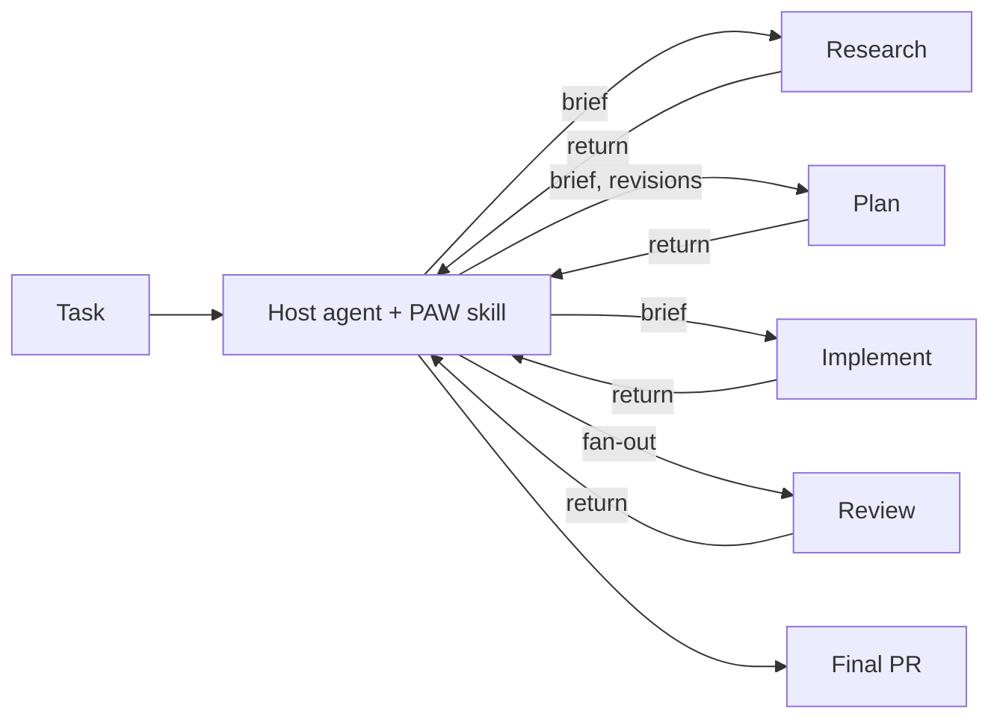

# PAW v2 Design

!!! note "Status: implemented"
    Phase 0 output for [#322](https://github.com/lossyrob/phased-agent-workflow/issues/322). Phases 0–7 are implemented on the `v2` branch (PR [#331](https://github.com/lossyrob/phased-agent-workflow/pull/331)), including git and lifecycle (resume, rewind, `commit-and-persist`, worktree mode), compatibility and cutover (see [Cutover as implemented](#cutover-as-implemented)), PAW Review alignment (see [PAW Review alignment](#paw-review-alignment)) and the user-facing docs. Runtime coverage is recorded in [Runtime Capabilities](runtime-capabilities.md). The [decisions](#decisions) at the end were accepted on 2026-11-09.

Companion pages: [Invariant Catalogue](invariants.md) and [Runtime Capabilities](runtime-capabilities.md).

## Shape

PAW v2 is one workflow skill that a host agent loads. The host orchestrates; activities run in subagents; the host's TODO graph is the only control state.



| Component | Role |
|-----------|------|
| Workflow skill | The TODO graph template, the host rules, the contracts on this page |
| Activity briefs | One file per activity under the skill's `references/`; read by the subagent, not the host |
| Operation procedures | Git operations, final PR, resume, rewind; loaded by the host when the matching step starts |
| Review providers | Single-model, multi-model, society-of-thought (`paw-sot`, unchanged) |
| `PAW` agent | Thin wrapper that loads the skill; kept for compatibility |

## Activities

| Activity | Runs in | When | Output |
|----------|---------|------|--------|
| Setup | Host | Always | Work directory, `WorkflowContext.md`, branch |
| Shape | Host (interactive) | Configured, or the task is vague | `WorkShaping.md` |
| Specify | Persistent subagent | Configured | `Spec.md` |
| Research | Subagent, parallel where independent | Dedicated when configured; otherwise inside planning | `CodeResearch.md` or findings in the return |
| Plan | Persistent subagent | Always | `ImplementationPlan.md` |
| Plan review | Review provider | Configured | Review output under `reviews/planning/` |
| Plan checkpoint | Host (human pause) | Configured | User acceptance |
| Implement | One subagent per phase or work item; parallel only for independent items | Always | Commits |
| Phase review | Subagent | Configured | Verdict |
| Final review | Review provider | Configured | Review output under `reviews/` |
| Final PR | Host, through the final PR procedure | Always | Pull request |

Only Setup, Shape, the plan checkpoint and the Final PR run in the host. Review fan-out is launched by the host so reviewers are first-level subagents on every runtime.

## Host rules

The workflow skill gives the host a short, fixed set of rules. Each traces to the [catalogue](invariants.md).

1. Build the complete TODO graph from the resolved configuration before starting work (W1, W2).
2. Work the graph: start any unblocked node; delegate activities with a brief.
3. Treat every return as a claim. Check it against git and the artifacts before closing the node (D2, D3, W3).
4. Close a required node only with evidence. Cancel one only when the user says so (W3, W4).
5. Run configured procedures as configured, or block (W5).
6. Own every external side effect: push, PR, artifact tracking (D5, G4, G9).
7. Yield only when the graph is complete, a decision is needed, a configured checkpoint is reached, or the user asks (W8).
8. Report final status from live state (G10).

## TODO graph

### Template

Nodes are created at load time. Nodes for activities that the configuration turns off are not created.

```text
setup
shape            (if configured)         blocked by: setup
specify          (if configured)         blocked by: shape | setup
research         (if dedicated)          blocked by: specify | shape | setup
plan                                     blocked by: research | specify | shape | setup
plan-review      (if configured)         blocked by: plan
plan-checkpoint  (if configured)         blocked by: plan-review | plan
expand-plan                              blocked by: plan-checkpoint | plan-review | plan
final-review     (if configured)         blocked by: expand-plan
final-pr                                 blocked by: final-review | expand-plan
```

`expand-plan` runs when the plan is accepted. The host adds one `implement:<unit>` node per phase or work item, with the dependencies the plan states, and makes `final-review` (or `final-pr`) blocked by all of them. If phase review is configured, each unit also gets a `review:<unit>` node.

### Node content

Each node carries what the host needs when it gets there, so obligations do not depend on memory of the configuration:

- the activity and its brief or procedure;
- the configured provider and settings, for review nodes (for example `society-of-thought, debate, all specialists, via paw-sot`);
- the evidence required to close it.

### Changes during a run

| Event | Graph change |
|-------|--------------|
| Review returns findings | Add `revise:<target>` blocked-by the review; re-review per provider settings |
| Subagent returns `blocked` or `needs-decision` | Node stays open; host resolves or asks the user |
| Subagent returns candidates | Add `candidate:<slug>`; `final-pr` is blocked by it until resolved |
| User changes configuration | Host adds or cancels nodes and says so |
| Rewind | Reopen the target node and everything downstream |

### Portability

The template is written as nodes and `blocked by` relations. Hosts with dependency-aware stores use them. Hosts with a flat list keep dependency order and write the relation in the item text. Subagents do not write to the store. See [Runtime Capabilities](runtime-capabilities.md#todo-graph).

## Contracts

### Delegation brief

What the host sends when it starts an activity.

| Field | Content |
|-------|---------|
| Activity | One activity, and the path of its brief file |
| Intent | What the task is for, in the host's words |
| Host instructions | Project and user rules that apply to the activity. Subagents do not inherit them; see [probe results](runtime-capabilities.md#probe-results) |
| Task source | Issue or work item link, or the prompt text |
| Work context | Work directory, target branch, execution checkout |
| Inputs | Paths of the artifacts to read |
| Constraints | Scope limits, decisions already made, things not to change |
| Done when | Observable completion criteria |
| Limits | Commit locally with selective staging; do not push, open PRs, change artifact tracking, or orchestrate other activities |
| Return | The return contract below |

The host does not paste artifact contents into the brief. Subagents read from disk.

### Return contract

What every activity subagent sends back.

```yaml
status: complete | blocked | needs-decision | failed
activity: plan
summary: <three to six sentences on what was done and why>
artifacts:
  - path: .paw/work/<work-id>/ImplementationPlan.md
commits:
  - <sha> <subject>
validation:
  - command: npm test
    result: pass
deviations:
  - <where the work departed from the brief or plan, and why>
blockers:
  - <what stops progress and what would resolve it>
decisions_needed:
  - question: <decision>
    options: [<a>, <b>]
    recommendation: <a>
candidates:
  - <related work noticed but not done>
```

Empty lists are omitted. Review activities add `verdict` and `findings` (each with severity, location and proposed fix).

### Host acceptance

Before closing a node the host checks:

| Activity | Check |
|----------|-------|
| Any | Listed artifacts exist and are non-empty; listed commits exist on the target branch; no unrelated files changed |
| Specify, Plan | No placeholders or open blocking questions; consistent with the task and with decisions made in conversation |
| Implement | Every deliverable the plan names for the unit exists with real content; stated validation passed |
| Review | Output exists in the form the configured provider produces |

A failed check becomes a revision, not a closed node.

### Revision packet

What the host sends for each revision round.

| Field | Content |
|-------|---------|
| Artifact | Path and the commit it was last accepted or returned at |
| Requested change | The delta, stated specifically |
| Accepted decisions | Cumulative list from all earlier rounds |
| Constraints and intent | Restated, not assumed |
| Must not regress | Points corrected earlier that must stay corrected |

The packet goes to the same subagent where the runtime supports follow-up, and to a fresh subagent otherwise. On Copilot CLI, follow-up needs the subagent to have been started in background mode, so Specify and Plan are started that way. The host compares the result with the previous version before accepting it.

## Configuration

### Model

About 40 parameters reduce to the following. `WorkflowContext.md` stays configuration-only.

| Field | Values | Default |
|-------|--------|---------|
| `base_branch`, `target_branch` | branch names | `main`, derived |
| `execution_mode` | `current-checkout`, `worktree` | `current-checkout` |
| `artifact_lifecycle` | `commit-and-clean`, `commit-and-persist`, `never-commit` | `commit-and-clean` |
| `shaping` | `off`, `on`, `auto` | `auto` |
| `spec` | `off`, `on` | `off` |
| `research` | `inline`, `dedicated` | `inline` |
| `planning.models` | one or more models | session model |
| `plan_review` | review provider block | `single-model` |
| `plan_checkpoint` | `off`, `on` | `off` |
| `implementation.phases` | `auto`, `single` | `auto` |
| `implementation.parallel` | `auto`, `off` | `auto` |
| `implementation.model` | model | session model |
| `phase_review` | `off`, `on` | `off` |
| `final_review` | review provider block | `multi-model` |
| `instructions` | free text | none |

A **review provider block** is used for both plan review and final review:

| Field | Values |
|-------|--------|
| `mode` | `off`, `single-model`, `multi-model`, `society-of-thought` |
| `models` | model list or specialist model assignment; for `multi-model` the default is the session model plus one model from another vendor |
| `specialists`, `interaction`, `perspectives`, `perspective_cap` | As `paw-sot` defines them; only for `society-of-thought` |

This replaces 18 paired `final_review_*` and `planning_review_*` fields with one block used twice.

The field reference, preset lookup and `WorkflowContext.md` format live in the skill's `references/configuration.md`; the provider procedures live in `references/review-providers.md`.

Provider behaviour as implemented:

- `multi-model`: the host starts one `review` subagent per model (per-call `model`), each writing `REVIEW-<model>.md`; a further `review` subagent with target `synthesis` writes `REVIEW-SYNTHESIS.md`.
- `society-of-thought`: the host loads `paw-sot` and runs it with `interactive: false`; moderator mode is not used.
- Re-review after a `must-fix`: `single-model` runs again; `multi-model` and `society-of-thought` get one `review` subagent with target `recheck` against the synthesis (`REVIEW-RECHECK.md`) instead of a second full fan-out.
- Several `planning.models`: one plan subagent per model writes `ImplementationPlan-<model>.md`; the first one merges them into `ImplementationPlan.md` and takes all revisions.

### Removed fields

| Removed | Replacement |
|---------|-------------|
| `workflow_mode` (`full`, `minimal`, `custom`) | `spec`, `research`, `implementation.phases`, `instructions` |
| `review_policy` (four values) | `plan_checkpoint` |
| `review_strategy` (`prs`, `local`) | Final PR only |
| `session_policy` | None; one session |
| `final_agent_review`, `planning_docs_review` | `mode: off` in the provider block |
| `*_interactive` | Findings applied autonomously; trade-offs return as `needs-decision` |
| `plan_generation_mode` | Number of entries in `planning.models` |

### Presets

| v2 preset | Settings | Replaces |
|-----------|----------|----------|
| `lite` | Inline research, single phase unless the plan says otherwise, single-model reviews | `paw-lite`, `quick` |
| `standard` (default) | Table defaults | `auto`, `standard` |
| `thorough` | Spec on, dedicated research, multi-model planning, SoT plan review, phase review on, SoT debate final review | `auto-full`, `thorough` |

`shaping: on` and `plan_checkpoint: on` are overrides on any preset, which covers `shaping-full` and the interactive use of `standard`. User presets in `~/.paw/presets/` keep working with the new field names; they take precedence over built-in presets of the same name. Old names map as `quick`, `paw-lite` → `lite`; `auto` → `standard`; `auto-full` → `thorough`; `shaping-full` → `thorough` with `shaping: on`; `team` → `standard`, with a notice that PR-per-phase review no longer exists. An unknown preset or field is reported and the host asks before continuing.

## Artifacts

| Artifact | Change from today |
|----------|-------------------|
| `WorkflowContext.md` | Fewer fields; never holds progress |
| `WorkShaping.md`, `Spec.md`, `CodeResearch.md` | Optional, per configuration |
| `ImplementationPlan.md` | One plan artifact for all presets (replaces Lite's `Plan.md`); records decisions, not a progress ledger |
| `reviews/` | Unchanged |
| `Docs.md`, `SpecResearch.md` | Not required; written when the plan calls for them |

## Git and lifecycle

Procedures live in the skill's `references/procedures/` (`git.md`, `final-pr.md`, `resume.md`, `rewind.md`).

| Concern | Behaviour |
|---------|-----------|
| Branch | Every commit happens on the target branch. If the checkout is elsewhere, the host switches first (`git switch`, which carries the user's uncommitted files) (G7). |
| `execution_mode: worktree` | Setup runs `git worktree add -b <target> <parent>/<repo>-<work-id> <base>`. All files, git commands and briefs use that path; the caller checkout is never written. The host checks top level and branch before each mutation and stops if either is wrong (G8). |
| `commit-and-clean` | Artifacts are committed during the run; the final PR procedure stops tracking `.paw/work/<work-id>/` only (G3, G5). |
| `commit-and-persist` | Artifacts are committed and stay tracked; no stop-tracking step (G5). |
| `never-commit` | No `.paw/` file is staged (G5). |
| Ignore markers | `.gitignore` files under the work directory are never staged (G6). |

### Resume

A new session that continues a work item finds `WorkflowContext.md` in the checkout, on another branch (`git log --all`), or in the work item's worktree, switches to the target branch, and rebuilds the TODO graph from the template. A node is closed only when its evidence exists now: the artifact, the review output, commits that deliver every planned deliverable of a unit with validation passing, or an open PR for the branch. Anything partial stays open. The host reports what it closed and continues without re-planning. A todo store that already holds the work item's todos is kept.

### Rewind

The user asks to go back or to change accepted work. The host previews the target node, the nodes it will reopen (the target and everything downstream) and how existing commits will be superseded, and changes nothing until the user confirms (G11). It then sets those nodes to `pending` (never deleting one), revises the target through its activity with a revision packet, and redoes affected units with new commits on top (or `git revert`). History is never rewritten and an existing PR is updated, not duplicated (G9, G12). A reopened node whose output the change does not affect closes again on its existing evidence.

Departures from the earlier draft and from v1:

- v1 `paw-rewind` reset the branch to a target commit. v2 never resets (G12); a rewind is reopened nodes plus new commits. Phase 5 reduced `paw-rewind` to a pointer to this procedure.
- Reconstruction closes a node only on present evidence, not on a best-effort guess.
- `WorkflowContext.md` does not record the worktree path; resume finds it with `git worktree list`.

## Compatibility

| Existing entry point | v2 behaviour |
|----------------------|--------------|
| `PAW` agent | Loads the workflow skill; no rules of its own |
| `paw-lite` skill | Loads the workflow skill with the `lite` preset |
| `paw-init` | Becomes the Setup step and configuration resolution |
| `paw-status`, `paw-rewind`, `paw-work-shaping`, `paw-sot` | Kept |
| `paw-transition` | Removed |
| `paw-spec`, `paw-planning`, `paw-implement`, research and review skills | Become activity briefs under the workflow skill (addresses [#271](https://github.com/lossyrob/phased-agent-workflow/issues/271)) |
| Old `WorkflowContext.md` | Read once through a mapping; unmapped combinations are reported, not guessed |
| Old preset names | Mapped per the table above, with a notice |
| VS Code `src/` | Remove session hand-off; keep initialisation, status and stop-tracking commands |

The original plan was that in-flight v1 work items are finished on v1 or restarted. As implemented, v2 resumes them; see the departures under [Cutover as implemented](#cutover-as-implemented).

### Cutover as implemented

| Entry | Outcome |
|-------|---------|
| `PAW` agent | Two lines: load `paw-workflow`; route status and "about PAW" questions to `paw-status` |
| `paw-lite` | Skill alias: load `paw-workflow` with preset `lite`. There was no `paw-lite` agent |
| `paw-rewind` | Pointer to the workflow's rewind procedure; never resets history (G12) |
| `paw-status` | Kept, rewritten for v2 configuration, presets and evidence |
| `paw-work-shaping`, `paw-sot`, `paw-review-*` | Kept. `paw-work-shaping` delegates research to a subagent instead of `paw-code-research` |
| `paw-review-response`, `paw-docs-guidance` | Kept (not named in the table above); `paw-review-response` no longer points at `paw-git-operations` |
| `paw-init`, `paw-transition`, `paw-spec`, `paw-spec-research`, `paw-spec-review`, `paw-code-research`, `paw-planning`, `paw-plan-review`, `paw-planning-docs-review`, `paw-implement`, `paw-impl-review`, `paw-final-review` | Deleted; replaced by Setup, configuration and the activity briefs |
| `paw-pr`, `paw-git-operations` | Deleted; replaced by the `git` and `final-pr` procedures |
| Old `WorkflowContext.md` | `references/v1-context.md`, read from the resume procedure |
| VS Code `src/` | `paw_new_session` removed. The init command asks for preset, plan checkpoint, artifact lifecycle and execution mode, and passes v2 field names. Status opens `paw-status` |
| CLI installer | Reinstall removes files the previous manifest recorded and the new version no longer ships |

Departures:

- v2 resumes a work item that v1 left in progress, instead of requiring it to be finished on v1 or restarted. The mapping converts `WorkflowContext.md` once to the v2 format; `Review Policy` (or `Handoff Mode`) maps to `plan_checkpoint` (`on` unless `final-pr-only`); `Workflow Mode: full` maps to `spec: on`, `research: dedicated`. Work left on `prs` intermediate branches is reported and the host asks before continuing.
- In VS Code worktree mode the extension still creates the worktree and opens the chat in it; the prompt tells the host that the checkout is the execution worktree. The skill's own worktree setup is used on the CLI.

## PAW Review alignment

PAW Review stays a separate workflow (`PAW-Review` agent, `paw-review-workflow` and the `paw-review-*` stage skills) and produces the same artifacts, pending review and human control points as before. It now uses the v2 contracts:

| Concern | As implemented |
|---------|----------------|
| `PAW-Review` agent | One line: load `paw-review-workflow`. Selection guidance, preflight and stage routing live only in the skill |
| Control plane | The review host builds a todo graph (`preflight`, `understanding`, `baseline`, `derived-spec`, `impact` and `gap` or `sot`, `correlation` for multi-repo, `feedback`, `critique`, `finalize`, `post`), closes each todo on the evidence the table names, and follows the v2 host rules. `ReviewContext.md` no longer carries an artifact checklist that stages tick off |
| Delegation | Each stage runs in a subagent with a brief (stage skill, contract path, target, artifact dir, host instructions, inputs, done-when, limits). Subagents read `paw-review-workflow/references/activity-contract.md` for the review principles, limits and return block, and never load `paw-review-workflow` (#297, D1) |
| Return contract | Every stage returns the v2 block: `status` (`complete`, `blocked`, `needs-decision`, `failed`), `activity`, `summary`, `artifacts`, `findings` (severity, location, issue, proposed fix; Must, Should and Could map to `must-fix`, `should-fix`, `consider`), `validation`, `blockers`, `decisions_needed`. The old `Success`/`Partial`/`Blocked` responses are gone |
| Review provider | `ReviewContext.md` records the review provider block (`mode`, `models`, `specialists`, `interaction`, `perspectives`, `perspective_cap`) plus PAW Review's `interactive`. Society-of-thought runs through the same `paw-sot` invocation as `paw-workflow`; if `paw-sot` cannot run, the review blocks (#268) |
| Side effects | Only the host posts: it loads `paw-review-github` in its own session. Subagents read the PR platform and never commit, push or post. Baseline research reads the base commit through git or a temporary worktree instead of checking it out, so the user's checkout and uncommitted files are never moved |

The provider block table and the `paw-sot` invocation are duplicated between the two skills, inside `<!-- shared:... -->` markers, because a skill cannot rely on reading another skill's `references/` (skills install separately and may come from different discovery paths). `tests/integration/tests/skills/review-shared-contracts.test.ts` fails if the copies differ, or if the review return block's shared entries differ from the `paw-workflow` briefs.

Departures and decisions:

- `PAW-Review` became a thin wrapper, mirroring the `PAW` agent. This page did not say so for PAW Review; the agent duplicated the skill's routing, which the catalogue classes as compensating machinery.
- PAW Review supports `single-model` (impact and gap analysis) and `society-of-thought`. `multi-model` and `off` are reported as unavailable and the host asks; no substitute runs. Its defaults are unchanged (`perspectives: none`, where `paw-workflow` defaults to `auto`), so the shared table carries values only and each workflow states its defaults.
- `paw-review-github` moved from a subagent stage to the host (G9 and the #297 rule that one actor owns GitHub side effects). Its behaviour is unchanged.
- `ReviewComments.md` keeps its `draft`/`finalized`/posted status and recorded review and comment IDs: they describe the comment set and make posting idempotent, not workflow progress.
- A local review whose base branch is unknown is asked in preflight by the host; the understanding subagent returns `needs-decision` instead of asking.
- `paw-review-response` is not part of PAW Review; it lost its references to planning, phase and docs PRs and to calling activity skills, and the host pushes and replies.

## Tests and budgets

Each durable invariant has one behavioural test (see the catalogue). Tests assert on tool calls, TODO state, git state and artifacts, not on prompt wording.

Phase 1 records a v1 baseline for the same fixture tasks before any v2 budget is fixed. Proposed measures:

| Measure | Definition | Target |
|---------|------------|--------|
| Autonomy | Human turns between task and PR on the default preset | 0 |
| Host context | Peak host-session tokens at PR creation | Set from baseline; must not grow with phase count |
| Instruction load | Tokens of the workflow skill plus the briefs the host reads | Below the current `PAW.agent.md` + `paw-workflow` + `paw-transition` total |
| Invariant pass rate | Catalogue tests passing over repeated runs | 100% on every run |
| Latency and cost | Wall-clock and total tokens per fixture task | Recorded; no target until baseline exists |

## Decisions

Accepted 2026-11-09.

| # | Decision | Outcome |
|---|----------|---------|
| 1 | PRs review strategy (planning, phase and docs PRs) | Removed. v2 produces one final PR. |
| 2 | Independent phase review | Off by default. Host acceptance covers plan completeness; `thorough` turns it on. |
| 3 | Default final review for `standard` | `multi-model`. `lite` uses single-model. |
| 4 | Presets | Three: `lite`, `standard`, `thorough`, with mappings for the old names. |
| 5 | #300 and #307 | Closed as superseded by the [Invariant Catalogue](invariants.md). |
| 6 | Branching | Built on a `v2` integration branch. |
| 7 | Workflow skill name | `paw-workflow`. |
